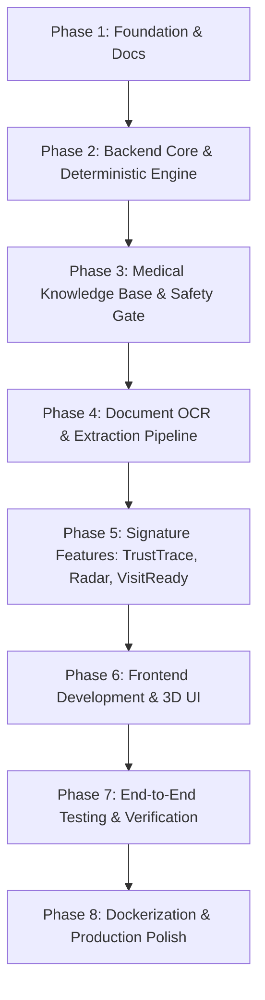

# LabLens — Master Implementation Plan

**Product:** LabLens | **Hackathon:** AAYU 2026 (T02) | **Team:** TriLogix (AAYU-MW2X)

---

## 🧭 Plan Phases

---

## Detailed Roadmap

### Phase 1: Foundation, Documentation, and Architecture
- Create comprehensive architecture, security, medical safety, data model, test plan, and limitations documents in `/docs`.
- Set up directory structure for frontend, backend, documentation, and synthetic fixtures.
- Author Docker Compose and environment specifications.

### Phase 2: Backend Core, Database, and Deterministic Classification
- Initialize FastAPI project with dependency injection and modular routers.
- Implement SQLAlchemy database models with strict foreign keys, timestamps, and audit tables.
- Build the **Deterministic Classification Engine** (`app/services/classification/engine.py`):
  - Strict numeric parsing, boundary interval evaluation (`[low, high]`, `(low, high)`).
  - Explicit handling of qualitative values (e.g., "Negative", "Non-reactive").
  - Refusal to guess missing ranges or convert incompatible units.
- Implement comprehensive unit tests for the classification engine.

### Phase 3: Medical Knowledge Base and Safety Explanation Engine
- Build authentic JSON knowledge base sourced from **MedlinePlus**, **ICMR**, **WHO**, **ARUP Consult**, and **Merck Manual**.
- Design Pydantic schemas for test parameters, verified aliases, and source citations.
- Implement the constrained explanation engine with strict fail-closed validation:
  - Verify every source ID exists in knowledge base.
  - Assert that explanations do not contain diagnostic assertions, disease probability claims, or prescription advice.
  - Implement approved multilingual templates (English, Hindi, Hinglish).

### Phase 4: Document Processing, OCR, and Verification Workspace
- Implement file upload validation (MIME sniffing, size limit 15MB, extension whitelist).
- Implement document parsing:
  - Text extraction from digital PDFs via PyMuPDF or pypdf / regex pattern matching.
  - OCR simulation / Tesseract adapter with bounding boxes and confidence scores.
  - Normalization of test names, numeric values, units, and ranges.
- Implement the **Verification Workspace API**:
  - Keep raw OCR and corrected values strictly separate.
  - Audit trail of edits (user ID, timestamp, original value, revised value).

### Phase 5: Signature Features (TrustTrace, Quality Radar, VisitReady, Comparability)
- **TrustTrace Service**: Assemble complete provenance graph from raw OCR snippet to normalized value, deterministic rule version, classification reason, and medical reference URL.
- **Report Quality Radar**: Compute readability heuristics (contrast, blur indicator, missing values, low-confidence fields, duplicated tests, missing dates).
- **VisitReady Builder**: Generate tailored, non-prescriptive doctor discussion questions and an appointment-ready summary.
- **Cross-Lab Comparability Gate**: Assess whether two reports are comparable before rendering trend charts.

### Phase 6: Frontend Application with Premium 3D Interaction
- Scaffold Vite + React + TypeScript + Tailwind CSS application.
- Build design system: Deep navy `#0B132B`, clean slate white `#F8FAFC`, vibrant cyan `#06B6D4`, restrained emerald `#10B981` accents.
- Implement 3D Hero Scene with React Three Fiber: Interactive biological/crystal lattice data visualization with fallback for reduced motion.
- Build all required screens:
  - Landing page with 3D hero and live interactive feature previews.
  - Verification Workspace (side-by-side report viewer and editable field cards).
  - Parameter Results Card with status pills and TrustTrace launcher.
  - TrustTrace Evidence Modal / Drawer.
  - Report Quality Radar Visualizer.
  - VisitReady Doctor Summary with PDF download and language selector (EN, HI, Hinglish).
  - Cross-Lab Trends with Comparability Guard.
  - Medical Resources Hub with live external link badges.
  - Teach-Back Interactive Mode.
  - Role-based views (Patient, Doctor, Admin).

### Phase 7: Testing, Safety Verification, and Hardening
- Backend test suite:
  - Classification engine unit tests (boundary limits, missing ranges, invalid units).
  - Medical safety refusal tests (anti-diagnosis prompt injection, medication alteration).
  - Role-based authorization tests (cross-patient access refusal, revoked doctor access refusal).
- Frontend test suite (component tests, formatters, verification flows).
- Synthetic report fixtures for CBC, Lipid Profile, and Metabolic Panels (both clear and degraded).

### Phase 8: Final Integration, Docker Compose, and Status Documentation
- Configure multi-stage Dockerfiles and `docker-compose.yml`.
- Verify full end-to-end user journey.
- Finalize `PROJECT_STATUS.md` with honest test outputs and verification records.
