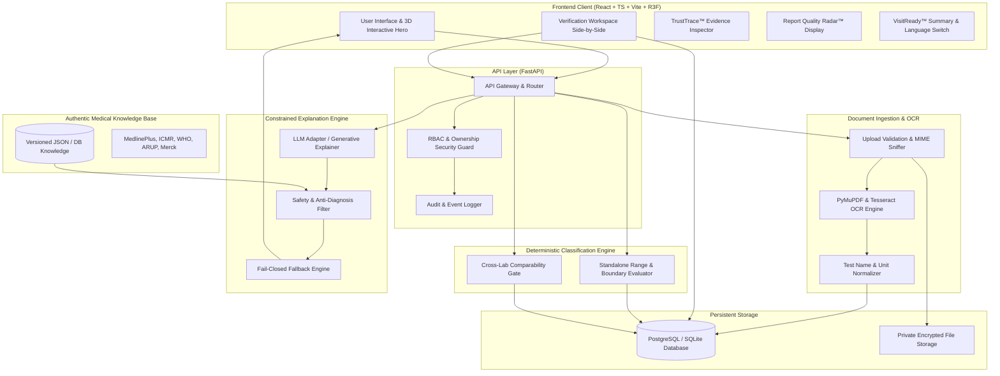

# LabLens — System Architecture

**Product:** LabLens | **Hackathon:** AAYU 2026 (T02) | **Team:** TriLogix (AAYU-MW2X)

---

## 🏛️ High-Level System Architecture

LabLens enforces a strict separation between unstructured document extraction, deterministic medical-interval classification, authentic educational knowledge retrieval, and generative natural language explanations.

---

## 🧩 Architectural Components

### 1. Ingestion and Extraction Engine
- **MIME & Header Validation**: Validates file magics (`%PDF`, `\xFF\xD8\xFF`, `\x89PNG`) to prevent file extension spoofing.
- **Bounding-Box Extraction**: Preserves page numbers and coordinate geometries (`[x0, y0, x1, y1]`) along with text tokens.
- **Confidence Scoring**: Each token carries an OCR confidence metric ($0.0 \le c \le 1.0$), flagging low-confidence values ($< 0.85$) for human verification.

### 2. Verification Workspace
- **Immutability of Raw Extraction**: The original OCR extraction is preserved as a permanent historical record.
- **User Correction Layer**: When users verify or correct a parameter, a separate audit record stores who corrected it, the prior value, the new value, and the verification timestamp.
- **Unverified Guard**: Any parameter missing user verification on critical boundaries is tagged as `Needs Verification` and blocked from automatic final reporting.

### 3. Deterministic Classification Engine (`v1.0.0`)
- **Principle**: Pure algorithmic evaluation with zero probabilistic AI intervention.
- **Interval Bounds**:
  - `In Range`: $Low \le Value \le High$ (standard inclusive interval)
  - `Below Range`: $Value < Low$
  - `Above Range`: $Value > High$
  - `Needs Verification`: Ambiguous numeric format, missing reference interval on report, or unconfirmed qualitative text.
  - `Unable to Classify`: Unsupported unit or invalid non-numeric token for quantitative tests.
- **Precision**: Uses standard floating-point / Decimal representations up to 4 decimal places with strict IEEE-754 round-to-nearest-even semantics.

### 4. Authentic Medical Knowledge Base
- Structured repository indexed by normalized test identifiers (e.g., `CBC_HEMOGLOBIN`, `LIPID_TOTAL_CHOLESTEROL`).
- Each entry contains approved definitions, purpose descriptions, clinical caveats, and traceable citations to **MedlinePlus**, **ICMR**, and **WHO**.
- Versioned with human review timestamps and reviewer badges.

### 5. Constrained AI Explanation Engine & Safety Guard
- The explanation generator takes as inputs:
  1. The verified test name, value, and unit.
  2. The deterministic classification status and reason.
  3. The approved knowledge base snippets.
- **Safety Gate**:
  - Rejects any output containing diagnostic terms ("You have anemia", "indicates diabetes").
  - Strips prescription instructions or medication adjustments.
  - Verifies that all cited source IDs belong to approved knowledge base entries.
  - **Fail-Closed**: If validation fails for any reason, the system replaces the output with a standardized safe disclaimer:
    > *"We couldn't safely explain this result from the available information. Please verify the report and discuss it with a qualified healthcare professional."*

### 6. Signature Feature: TrustTrace™
- Constructs a full cryptographic/traceable lineage for every displayed parameter:
  - Source File Hash -> Page Number -> Bounding Box -> Raw OCR String -> User Correction Audit -> Rule Engine Version -> Result Status -> Knowledge Source URL.

### 7. Signature Feature: Report Quality Radar™
- Runs 6 deterministic heuristic checks on every processed document:
  1. Page contrast & blur estimation.
  2. Completeness of mandatory fields (Name, Value, Unit, Reference Interval).
  3. OCR confidence distribution.
  4. Decimal point ambiguity check (e.g., `12` vs `1.2`).
  5. Duplicate test detection.
  6. Date & patient metadata presence.
- Categorizes document readiness: `Readable`, `Needs Review`, `Incomplete`, `Unsupported`.

### 8. VisitReady™ Doctor Conversation Builder
- Synthesizes verified out-of-range findings and patient-reported context into clinician discussion prompts.
- Employs an approved medical question bank:
  - "What could explain this level in the context of my overall health?"
  - "Are there dietary or lifestyle factors that influence this reading?"
  - "Do you recommend a re-test or follow-up evaluation?"
- Generates localized summaries in **English**, **Hindi**, and **Hinglish**.

### 9. Frontend 3D & Responsive Architecture
- Built on **React 18**, **TypeScript**, **Vite**, **Tailwind CSS**, and **React Three Fiber**.
- Features an interactive 3D hero rendering an organic biological / data-lattice sculpture reflecting lab accuracy and digital clarity.
- Implements `prefers-reduced-motion` detection, rendering graceful high-fidelity 2D canvas/SVG fallbacks for accessibility and constrained devices.
