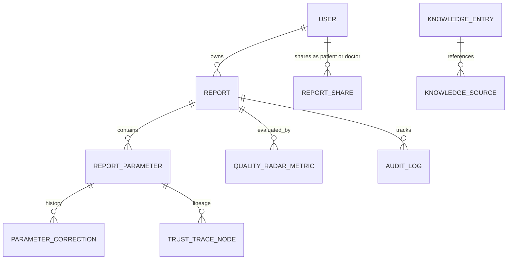

# LabLens — Data Model & Entity Specifications

**Product:** LabLens | **Hackathon:** AAYU 2026 (T02) | **Team:** TriLogix (AAYU-MW2X)

---

## 🗄️ Relational Schema Overview

---

## 📋 Entity Definitions

### 1. `users`
- `id`: UUID (Primary Key)
- `email`: VARCHAR(255) (Unique, Indexed, NOT NULL)
- `hashed_password`: VARCHAR(255) (NOT NULL)
- `full_name`: VARCHAR(255) (NOT NULL)
- `role`: ENUM ('patient', 'doctor', 'admin') (NOT NULL, Default 'patient')
- `created_at`: TIMESTAMPTZ (NOT NULL)
- `updated_at`: TIMESTAMPTZ (NOT NULL)

### 2. `reports`
- `id`: UUID (Primary Key)
- `owner_id`: UUID (Foreign Key -> `users.id`, Indexed, NOT NULL)
- `file_name`: VARCHAR(255) (Original upload name, NOT NULL)
- `storage_path`: VARCHAR(512) (Encrypted storage location, NOT NULL)
- `file_hash_sha256`: VARCHAR(64) (Integrity verification hash, NOT NULL)
- `file_size_bytes`: INTEGER (NOT NULL)
- `mime_type`: VARCHAR(64) (NOT NULL)
- `privacy_mode`: ENUM ('private_history', 'temporary_session') (NOT NULL)
- `status`: ENUM ('uploaded', 'processing', 'extracted', 'verified', 'archived') (NOT NULL)
- `report_date`: DATE (Extracted or user-confirmed report date)
- `lab_name`: VARCHAR(255) (Name of testing facility)
- `created_at`: TIMESTAMPTZ (NOT NULL)
- `updated_at`: TIMESTAMPTZ (NOT NULL)

### 3. `report_parameters`
- `id`: UUID (Primary Key)
- `report_id`: UUID (Foreign Key -> `reports.id` ON DELETE CASCADE, NOT NULL)
- `test_name`: VARCHAR(255) (Normalized test name, e.g. "Hemoglobin", NOT NULL)
- `canonical_code`: VARCHAR(64) (LOINC or system standard code, e.g. "CBC_HEMOGLOBIN")
- `raw_text`: TEXT (Exact OCR string extracted from document, NOT NULL)
- `raw_value`: VARCHAR(64) (Extracted string value, e.g. "13.4")
- `numeric_value`: NUMERIC(10, 4) (Parsed numeric value for comparison)
- `unit`: VARCHAR(64) (Verified unit, e.g. "g/dL")
- `reference_range_raw`: VARCHAR(128) (Original range text, e.g. "12.0 - 15.5")
- `range_low`: NUMERIC(10, 4) (Parsed lower bound)
- `range_high`: NUMERIC(10, 4) (Parsed upper bound)
- `ocr_confidence`: NUMERIC(4, 3) (Confidence score 0.000 to 1.000)
- `page_number`: INTEGER (1-based index)
- `bounding_box`: JSONB (`{ x0: float, y0: float, x1: float, y1: float }`)
- `verification_status`: ENUM ('auto_extracted', 'user_verified', 'user_corrected', 'needs_review') (NOT NULL)
- `classification_status`: ENUM ('In Range', 'Below Range', 'Above Range', 'Needs Verification', 'Unable to Classify') (NOT NULL)
- `classification_reason`: TEXT (Detailed deterministic reason)
- `rule_engine_version`: VARCHAR(32) (NOT NULL, e.g. "1.0.0")

### 4. `parameter_corrections`
- `id`: UUID (Primary Key)
- `parameter_id`: UUID (Foreign Key -> `report_parameters.id` ON DELETE CASCADE, NOT NULL)
- `user_id`: UUID (Foreign Key -> `users.id`, Actor who made correction)
- `field_name`: VARCHAR(64) ("test_name", "numeric_value", "unit", "range_low", "range_high")
- `old_value`: TEXT
- `new_value`: TEXT
- `reason`: TEXT
- `corrected_at`: TIMESTAMPTZ (NOT NULL)

### 5. `report_shares`
- `id`: UUID (Primary Key)
- `report_id`: UUID (Foreign Key -> `reports.id` ON DELETE CASCADE, NOT NULL)
- `doctor_id`: UUID (Foreign Key -> `users.id`, Target doctor)
- `shared_by_user_id`: UUID (Foreign Key -> `users.id`, Patient granting access)
- `is_active`: BOOLEAN (Default TRUE, set to FALSE immediately upon revocation)
- `expires_at`: TIMESTAMPTZ
- `created_at`: TIMESTAMPTZ (NOT NULL)
- `revoked_at`: TIMESTAMPTZ

### 6. `quality_radar_evaluations`
- `id`: UUID (Primary Key)
- `report_id`: UUID (Foreign Key -> `reports.id` ON DELETE CASCADE, NOT NULL)
- `status`: ENUM ('Readable', 'Needs Review', 'Incomplete', 'Unsupported') (NOT NULL)
- `readability_score`: NUMERIC(3, 2) (0.00 to 1.00)
- `findings`: JSONB (Array of detected issues: `{ check: str, severity: str, message: str, remediation: str }`)
- `evaluated_at`: TIMESTAMPTZ (NOT NULL)

### 7. `audit_logs`
- `id`: UUID (Primary Key)
- `user_id`: UUID (Actor)
- `report_id`: UUID (Target resource)
- `action`: VARCHAR(64) ('upload', 'view', 'verify', 'correct', 'share', 'revoke', 'export_pdf', 'delete')
- `ip_address_hash`: VARCHAR(64)
- `details`: JSONB
- `timestamp`: TIMESTAMPTZ (NOT NULL)
